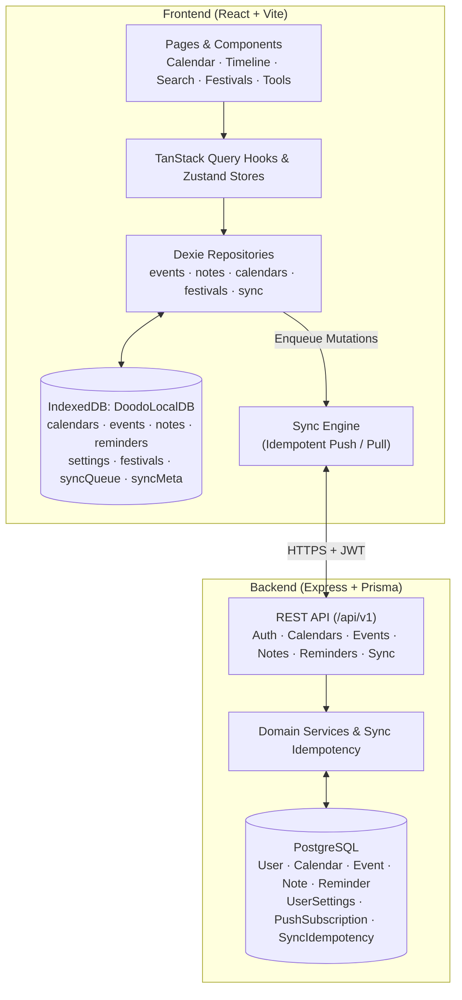

# Doodo — Offline-First Personal Calendar & Life-Archive

Doodo is an **offline-first personal calendar, digital diary, and lifelong memory-archive application** built with React, TypeScript, Dexie.js (IndexedDB), TanStack Query, Zustand, Express, Prisma, and PostgreSQL.

It is designed around a single core principle: **your calendar, memories, notes, and planning tools work instantaneously offline**, while seamlessly synchronizing with the cloud when connectivity is available.

---

## Table of Contents

- [Key Capabilities](#key-capabilities)
- [Tech Stack](#tech-stack)
- [Overall Workflow & Architecture](#overall-workflow--architecture)
- [Technical Implementation](#technical-implementation)
  - [1. Offline-First Storage & Sync Engine](#1-offline-first-storage--sync-engine)
  - [2. Calendar Engine & Workspaces](#2-calendar-engine--workspaces)
  - [3. Events, Recurrence & Web Push Reminders](#3-events-recurrence--web-push-reminders)
  - [4. Notes & Digital Diary](#4-notes--digital-diary)
  - [5. Chronological Timeline](#5-chronological-timeline)
  - [6. Global Search](#6-global-search)
  - [7. Festival & Holiday Calendar](#7-festival--holiday-calendar)
  - [8. Date Calculator, Countdowns & Smart Tools](#8-date-calculator-countdowns--smart-tools)
- [Project Structure](#project-structure)
- [Getting Started](#getting-started)
- [Scripts & Verification](#scripts--verification)

---

## Key Capabilities

- **Calendar Engine**: Month-grid calendar with keyboard navigation, customizable week start, multi-calendar workspaces (colors, emojis, visibility, archive), and a responsive selected-date detail panel.
- **Events & Recurrence**: All-day and timed events, priority levels, highlight styles, locations, and dynamic recurrence expansion (`daily`, `weekly`, `monthly`, `yearly`).
- **Digital Diary & Notes**: Rich date-bound notes and reflections with sanitized HTML storage and plain-text snippet extraction.
- **Reminders & Web Push**: Scheduled reminders powered by `web-push` and service worker notifications.
- **Offline-First & Cloud Sync**: Local IndexedDB (`DoodoLocalDB`) via Dexie.js with an idempotent `syncQueue` and server-side `SyncIdempotency` tracking.
- **Chronological Timeline**: Infinite-horizon life archive grouped by `Year → Month → Date → Entries` across past, present, and future.
- **Global Search**: Instant client-side search (`Ctrl+K` / `Cmd+K` on desktop, dedicated screen on mobile) across events, notes, calendars, and festivals with safe tokenized highlighting.
- **Festival & Holiday Calendar**: Offline reference dataset (prioritizing India & Tamil Nadu for 2025–2027) with category/region filtering, provenance metadata, and calendar integration.
- **Date Calculator & Smart Tools**: Duration add/subtract with month-end clamping, DST-safe inclusive/exclusive date difference, live event countdowns, and an inline calculator inside the calendar's selected-date panel.

---

## Tech Stack

| Layer | Technologies |
| --- | --- |
| **Frontend** | React 19, TypeScript, Vite 8, React Router 6, Tailwind CSS, Radix UI, Framer Motion, Lucide Icons |
| **State & Caching** | TanStack Query v5 (async/local data caching & invalidation), Zustand v5 (lightweight UI state) |
| **Offline Storage** | Dexie.js v4 (IndexedDB wrapper) |
| **Backend API** | Node.js, Express 4, TypeScript, Zod validation, Winston & Morgan logging |
| **Auth & Security** | JWT access/refresh tokens, `bcryptjs`, Google Auth (`google-auth-library`), Helmet, CORS, Rate Limiting |
| **Database** | PostgreSQL with Prisma ORM v6 (`@prisma/adapter-pg`) |
| **Notifications** | `web-push` + Service Worker (`public/sw.js`) |
| **Quality & Tests** | `oxlint`, TypeScript `tsc`, Node.js built-in test runner (`node:test` + `tsx`) |

---

## Overall Workflow & Architecture

Doodo follows a **local-first read/write workflow**: the UI reads from and writes to IndexedDB first, updates TanStack Query caches immediately for zero-latency feedback, and enqueues mutations for background cloud synchronization.



### Navigation & Layout Philosophy
- **No permanent sidebar**: Desktop uses a minimal top navigation bar (`Calendar`, `Timeline`, `Festivals`, `Tools`, global search trigger, calendar switcher, and profile menu).
- **Mobile-first bottom navigation**: Mobile and tablet screens use a fixed bottom navigation bar (`Calendar`, `Search`, `Festivals`, `Tools`, `Timeline`, `Settings`) with a slide-up sheet for selected-date details.
- **Calendar as Home**: `/calendar` is always the primary workspace after authentication.

---

## Technical Implementation

### 1. Offline-First Storage & Sync Engine
- **Single IndexedDB Instance** ([doodo-db.ts](file:///d:/Projects/Personal-Management-System/frontend/src/db/doodo-db.ts)):
  - **v1**: `calendars`, `events`, `notes`, `settings`, `syncQueue`, `syncMeta`.
  - **v2**: Added `reminders`.
  - **v3**: Added `festivals` reference table (`id, date, year, category, *region`).
- **Mutation Flow**:
  1. User creates/updates/deletes an entity (calendar, event, note, reminder, or settings).
  2. Repository writes optimistically to IndexedDB with `syncStatus: "pending"` and `localUpdatedAt` timestamp (using soft-delete `deletedAt` tombstones for deletes).
  3. An operation entry with a stable UUID `operationId` is appended to `syncQueue`.
  4. `syncEngine` pushes pending operations to `/api/v1/sync` when online; the backend enforces idempotency via the `SyncIdempotency` Prisma model so retries never duplicate records.

### 2. Calendar Engine & Workspaces
- **Grid Generation** ([calendar.ts](file:///d:/Projects/Personal-Management-System/frontend/src/utils/calendar.ts)): Generates a 42-day (6-week) matrix aligned to the user's `weekStartsOn` preference (`0`, `1`, or `6`), with `dateKey(date)` producing timezone-safe `YYYY-MM-DD` keys.
- **Workspaces**: Users can create multiple calendars with custom names, emojis, and colors, toggle visibility, or archive workspaces without deleting historical records.
- **State Coordination**: `useCalendarStore` manages `visibleMonth`, transition `direction`, and `requestedDate` (used by Global Search, Festivals, and Smart Tools to jump directly to any date and open its detail panel).

### 3. Events, Recurrence & Web Push Reminders
- **Recurrence Expansion** ([recurrence.utils.ts](file:///d:/Projects/Personal-Management-System/frontend/src/utils/recurrence.utils.ts)): `expandEventOccurrences` dynamically projects `daily`, `weekly`, `monthly`, and `yearly` occurrences within any `[rangeStart, rangeEnd]` window without duplicating rows in IndexedDB or PostgreSQL, preserving duration and clamping month-end dates.
- **Reminders**: Stored locally in `db.reminders` and scheduled on the backend using `web-push` VAPID keys against `PushSubscription` records.

### 4. Notes & Digital Diary
- Notes are linked to calendar dates (`date`) and optionally to a workspace (`calendarId`).
- Content is sanitized via [html-sanitizer.utils.ts](file:///d:/Projects/Personal-Management-System/frontend/src/utils/html-sanitizer.utils.ts) for safe rendering and plain-text preview extraction (`extractPlainTextSnippet`).

### 5. Chronological Timeline
- **Repository & Grouping** ([timelineRepository.ts](file:///d:/Projects/Personal-Management-System/frontend/src/db/repositories/timelineRepository.ts), [timeline.utils.ts](file:///d:/Projects/Personal-Management-System/frontend/src/utils/timeline.utils.ts)): Aggregates non-archived events (including expanded recurrences) and notes across unrestricted historical and future ranges.
- **Hierarchy**: Groups entries into `Year → Month → Date → Entries`, highlights `TODAY`, and supports combined filtering (`All` / `Events` / `Notes`, `Past` / `Today` / `Upcoming`, calendar filter, and custom date ranges).

### 6. Global Search
- **IndexedDB Search Engine** ([searchRepository.ts](file:///d:/Projects/Personal-Management-System/frontend/src/db/repositories/searchRepository.ts), [search.utils.ts](file:///d:/Projects/Personal-Management-System/frontend/src/utils/search.utils.ts)):
  - Normalizes diacritics, whitespace, and casing (`normalizeSearchText`, `tokenizeQuery`) and scores matches across **Events**, **Notes**, **Calendars**, and **Festivals**.
  - **XSS-Safe Highlighting**: `HighlightedText` tokenizes matched substrings into React elements without `dangerouslySetInnerHTML`.
  - **Local-Only History**: Recent searches are stored strictly in `localStorage` per user and never uploaded to the backend.

### 7. Festival & Holiday Calendar
- **Reference Data Architecture** ([festival.types.ts](file:///d:/Projects/Personal-Management-System/frontend/src/types/festival.types.ts), [festivalRepository.ts](file:///d:/Projects/Personal-Management-System/frontend/src/db/repositories/festivalRepository.ts)):
  - Kept strictly separate from personal user events and sync queues.
  - Seeded idempotently into `db.festivals` on app startup (`ALL_FESTIVALS` covering 2025–2027).
  - Supports 7 categories (`national`, `state`, `hindu`, `muslim`, `christian`, `regional`, `international`), multi-region matching (`tamil-nadu`, `india`, `kerala`, etc.), provenance (`source`), and `isEstimate` flags for lunar-calendar dates.
- **UI**: Subtle indicators appear on [CalendarCell.tsx](file:///d:/Projects/Personal-Management-System/frontend/src/components/calendar/CalendarCell.tsx) and [SelectedDatePanel.tsx](file:///d:/Projects/Personal-Management-System/frontend/src/components/calendar/SelectedDatePanel.tsx), alongside a dedicated [FestivalsPage.tsx](file:///d:/Projects/Personal-Management-System/frontend/src/pages/festivals/FestivalsPage.tsx) and [FestivalSettingsPage.tsx](file:///d:/Projects/Personal-Management-System/frontend/src/pages/settings/FestivalSettingsPage.tsx).

### 8. Date Calculator, Countdowns & Smart Tools
- **Pure Date Arithmetic** ([date-calculator.utils.ts](file:///d:/Projects/Personal-Management-System/frontend/src/utils/date-calculator.utils.ts)):
  - Parses `YYYY-MM-DD` strictly as local midnight (`parseLocalDateInput`) to avoid UTC off-by-one shifts.
  - **Month-End & Leap-Year Clamping**: Adding/subtracting months or years clamps to `daysInMonth(targetYear, targetMonth)` (e.g., `2026-01-31 + 1 month → 2026-02-28`; `2024-02-29 + 1 year → 2025-02-28`).
  - **DST-Safe Difference**: Computes `exclusiveDays` and `inclusiveDays` using UTC midnight of local `Y/M/D` components, plus weeks/remaining days and calendar `years / months / days`.
- **Event Countdowns** ([useCountdowns.ts](file:///d:/Projects/Personal-Management-System/frontend/src/hooks/useCountdowns.ts)): Uses query key prefix `["events", "countdowns", userId]` so local event edits refresh countdowns immediately, resolving recurring birthdays/anniversaries via `expandEventOccurrences`.
- **Calendar Integration**: Available both on [ToolsPage.tsx](file:///d:/Projects/Personal-Management-System/frontend/src/pages/tools/ToolsPage.tsx) (`/tools`) and inline inside [SelectedDatePanel.tsx](file:///d:/Projects/Personal-Management-System/frontend/src/components/calendar/SelectedDatePanel.tsx) via the **Tools** button, allowing instant calculation and one-click navigation to the resulting date.

---

## Project Structure

```text
Personal-Management-System/
├── package.json                  # Root dev & test orchestration scripts
├── backend/
│   ├── prisma/schema.prisma      # PostgreSQL models (User, Calendar, Event, Note, Reminder, SyncIdempotency, etc.)
│   └── src/
│       ├── controllers/          # HTTP request handlers
│       ├── middleware/           # Auth, rate limiting, validation, error handling
│       ├── routes/               # Express v1 routes
│       └── services/             # Business logic & sync idempotency
└── frontend/
    ├── public/sw.js              # Service worker for offline & push notifications
    ├── tests/                    # Node test suites (timeline, search, festivals, tools)
    └── src/
        ├── components/           # Calendar, Events, Notes, Search, Timeline, Navigation, UI primitives
        ├── constants/            # Routes, navigation items, app constants
        ├── data/festivals/       # Static 2025–2027 festival reference datasets
        ├── db/                   # DoodoLocalDB (Dexie v3) & repositories
        ├── hooks/                # TanStack Query & domain hooks
        ├── pages/                # Route pages (Calendar, Timeline, Search, Festivals, Tools, Settings, Auth)
        ├── store/                # Zustand client UI stores
        ├── sync/                 # Offline sync engine
        ├── types/                # Shared TypeScript interfaces
        └── utils/                # Calendar, recurrence, timeline, search, festival, date-calculator utilities
```

---

## Getting Started

### 1. Prerequisites
- **Node.js** 20+
- **PostgreSQL** database

### 2. Install Dependencies
```bash
npm run install:all
```

### 3. Configure Environment
Set up `backend/.env` (database connection `DATABASE_URL`, JWT secrets, optional Google OAuth and VAPID Web Push keys) and `frontend/.env` as needed based on `frontend/.env.example`.

### 4. Generate Prisma Client & Run Migrations
```bash
npm run db:generate
npm run db:migrate
```

### 5. Run Development Servers
Starts both backend (`tsx watch`) and frontend (`vite`) concurrently:
```bash
npm run dev
```

---

## Scripts & Verification

| Command | Description |
| --- | --- |
| `npm run dev` | Run backend and frontend dev servers concurrently |
| `npm --prefix frontend run build` | Type-check (`tsc -b`) and build frontend production bundle |
| `npm --prefix backend run build` | Compile backend TypeScript (`tsc`) |
| `npm --prefix frontend run lint` | Run `oxlint` across frontend source files |
| `npm test` | Run all unit & integration tests (`timeline`, `search`, `festivals`, `tools`) via `tsx --test` |
